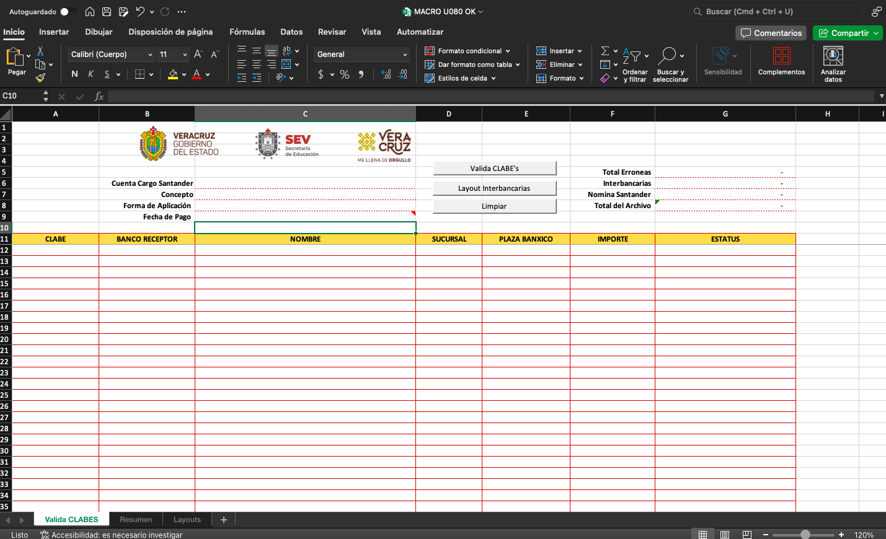
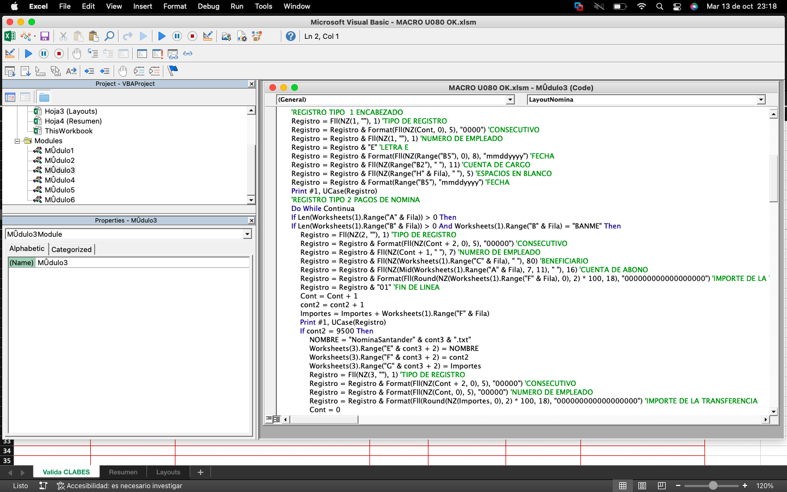

# macros-layouts-bancarios-excel

Herramientas en Excel con macros VBA para validar CLABEs y preparar layouts usados en procesos de dispersion de nomina, transferencias interbancarias y alta de cuentas en banca en linea.

## El problema

Los procesos de dispersion bancaria suelen requerir archivos con estructuras especificas por banco. Prepararlos manualmente desde hojas de calculo aumenta el riesgo de capturar CLABEs incorrectas, mezclar bancos, generar importes inconsistentes o producir layouts que la banca en linea rechace.

Este proyecto esta pensado para equipos administrativos, contables o de nomina que necesitan transformar informacion tabular en archivos compatibles con operaciones bancarias.

## La solucion

Los libros de Excel analizados contienen hojas para capturar o validar CLABEs, consultar un catalogo de bancos y resumir archivos de interbancarias. Las macros automatizan parte del proceso de validacion y generacion de layouts, reduciendo trabajo manual antes de cargar informacion en plataformas bancarias.

Por seguridad, los libros originales `.xlsm` no forman parte del contenido publicable de este repositorio. Los archivos revisados contienen datos bancarios/personales y deben mantenerse solo de forma local o sustituirse por plantillas completamente sanitizadas antes de publicar.

## Funcionalidades principales

- Validacion de CLABEs y asociacion con banco receptor.
- Catalogo de instituciones bancarias y claves bancarias.
- Preparacion de informacion para pagos, altas de cuentas y transferencias interbancarias.
- Resumen de archivos generados, numero de registros e importes.
- Soporte mediante macros VBA dentro de libros de Microsoft Excel.

## Que mejora este proyecto

- Reduce errores en layouts bancarios preparados manualmente.
- Centraliza catalogos y validaciones usadas en dispersion de pagos.
- Facilita revisar totales y registros antes de cargar archivos en banca en linea.
- Ayuda a separar informacion privada de documentacion publica del proyecto.

## Para quien esta pensado

- Areas de nomina.
- Equipos administrativos que generan dispersiones bancarias.
- Contabilidad o tesoreria.
- Personas responsables de preparar archivos para banca en linea.

## Tecnologias utilizadas

- Microsoft Excel habilitado para macros (`.xlsm`).
- VBA para automatizacion dentro de Excel.
- Formato Office Open XML usado internamente por los libros de Excel.

## Requisitos

- Microsoft Excel de escritorio con soporte para macros VBA.
- Permisos locales para habilitar macros solo si se confia en el archivo.
- Git, si se desea versionar documentacion o plantillas sanitizadas.

No se detectaron dependencias de Node.js, Python, Docker, bases de datos ni servicios externos.

## Instalacion

```bash
git clone <url-del-repositorio>
cd macros-layouts-bancarios-excel
```

Los libros reales con datos bancarios no deben agregarse al repositorio publico. Para trabajar localmente, coloca tus archivos privados en una carpeta ignorada por Git, por ejemplo:

```text
workbooks/
```

## Configuracion

El proyecto no requiere variables de entorno actualmente. Se incluye `.env.example` como marcador seguro para futuras automatizaciones.

## Ejecutar el proyecto

1. Abre una copia local y confiable del libro `.xlsm` en Microsoft Excel.
2. Habilita macros solamente si el archivo fue revisado y proviene de una fuente confiable.
3. Captura o importa los datos en la hoja de validacion.
4. Revisa el catalogo de bancos y el resumen generado.
5. Genera el layout requerido para la operacion bancaria correspondiente.
6. Valida el archivo resultante antes de cargarlo en la banca en linea.

## Uso

El flujo general consiste en preparar una hoja con columnas como CLABE, banco receptor, nombre, sucursal, plaza Banxico, importe y estatus. Las macros usan esa informacion para validar datos y organizar salidas por tipo de operacion o banco.

## Estructura del proyecto

```text
.
+-- README.md
+-- SECURITY.md
+-- .env.example
+-- .gitignore
+-- docs/
|   +-- publicar-macros-excel.md
+-- templates/
    +-- README.md
```

## Capturas

### Template 


### Codigo VBA 



## Seguridad

- No subas libros `.xlsm`, `.xls` o `.xlsx` con informacion real.
- No subas layouts bancarios generados con datos reales.
- Mantener los archivos privados en carpetas ignoradas por Git, como `workbooks/` o `private/`.
- Usar `.env.example` solo con placeholders si en el futuro se agregan variables de configuracion.
- Revisar metadatos de autor y propiedades del documento antes de compartir archivos de Excel.

## Publicar el codigo de las macros

Para publicar el codigo de forma revisable en GitHub, exporta los modulos VBA a archivos de texto:

```powershell
.\scripts\export-vba.ps1
```

El script crea carpetas dentro de `vba/` con los modulos `.bas`, `.cls` y `.frm` de cada libro `.xlsm` encontrado en la raiz del proyecto.

Antes de hacer commit de esos archivos:

- revisa que no contengan CLABEs, cuentas, nombres reales, rutas privadas o credenciales;
- confirma que los libros usados como origen ya fueron sanitizados;
- deja los `.xlsm` ignorados salvo que decidas publicar plantillas ficticias y revisadas.

Si Excel no expone los componentes VBA para exportacion, publica unicamente plantillas sanitizadas dentro de `templates/`. Consulta `docs/publicar-macros-excel.md` para el flujo completo.

## Pruebas

No existen pruebas automatizadas configuradas. La validacion actual debe hacerse abriendo una copia sanitizada del libro en Excel y ejecutando las macros con datos ficticios.

## Estado del proyecto

Version inicial documentada para revision. Los libros originales fueron identificados como no publicables por contener informacion sensible.

## Limitaciones actuales

- No hay codigo VBA extraido a archivos de texto versionables.
- Los libros originales no son aptos para publicacion publica sin sanitizacion.
- No hay pruebas automatizadas ni pipeline de validacion.
- La ejecucion depende de Microsoft Excel de escritorio.

## Proximas mejoras

- Crear plantillas `.xlsm` sanitizadas con datos ficticios.
- Extraer los modulos VBA a archivos `.bas`, `.cls` o `.frm` para revision por Git.
- Agregar una guia de sanitizacion de libros Excel.
- Incorporar pruebas manuales documentadas con casos ficticios.
- Definir una licencia si el proyecto se publicara como codigo abierto.

## Contribuciones

Antes de contribuir, usa datos ficticios y evita subir archivos bancarios reales. Para proponer cambios:

1. Crea un fork o una rama de trabajo.
2. Realiza cambios en documentacion, plantillas sanitizadas o codigo VBA exportado.
3. Verifica que no se agreguen datos sensibles.
4. Abre un pull request con una descripcion clara.

## Licencia

Este proyecto se publica bajo la licencia MIT. Consulta el archivo `LICENSE` para mas detalles.
